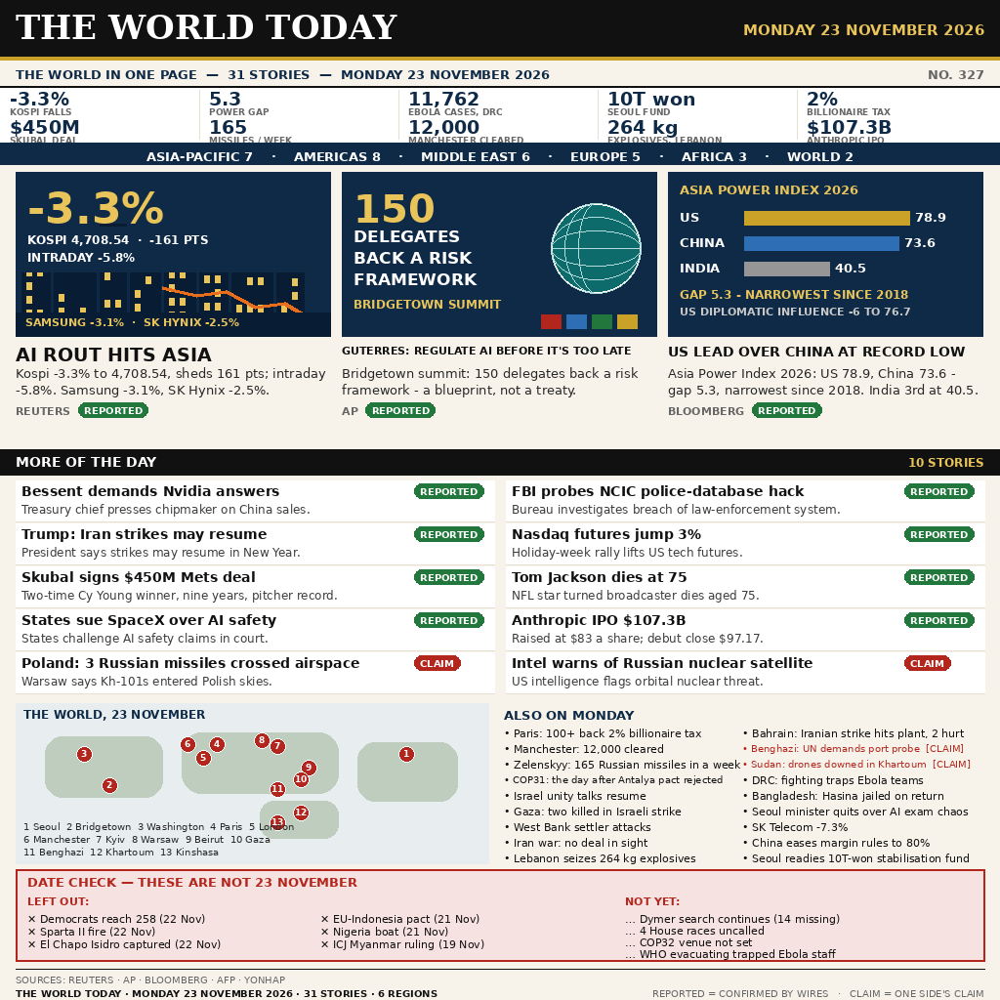

# THE WORLD TODAY — Monday 23 November 2026

[](https://make.fun/bounty/news-image-20261123)
[](https://make.fun/bounty/news-image-20261123)
[](https://make.fun/bounty/news-image-20261123)

One image summing up 23 November 2026's world news: the AI rout that hit
Asian markets (Kospi −3.3%), Guterres's call to regulate AI before it is too
late, and the US lead over China falling to a record low (gap 5.3) — plus 28
more stories across 6 regions, with a date check separating 23 November from
earlier days.



## How it is made

`draw.py` (Pillow) renders the 1024×1024 front page. `main.py` (stdlib only)
validates the PNG and copies it to `MAKEFUN_OUTPUT_DIR/entry.png`.

```sh
python3 draw.py            # renders entry.png
MAKEFUN_OUTPUT_DIR=out python3 main.py
```
